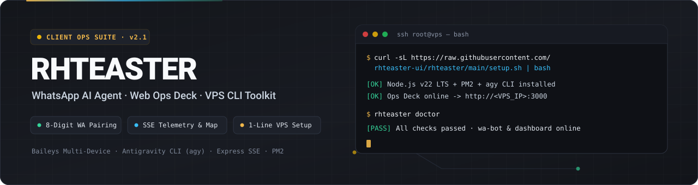
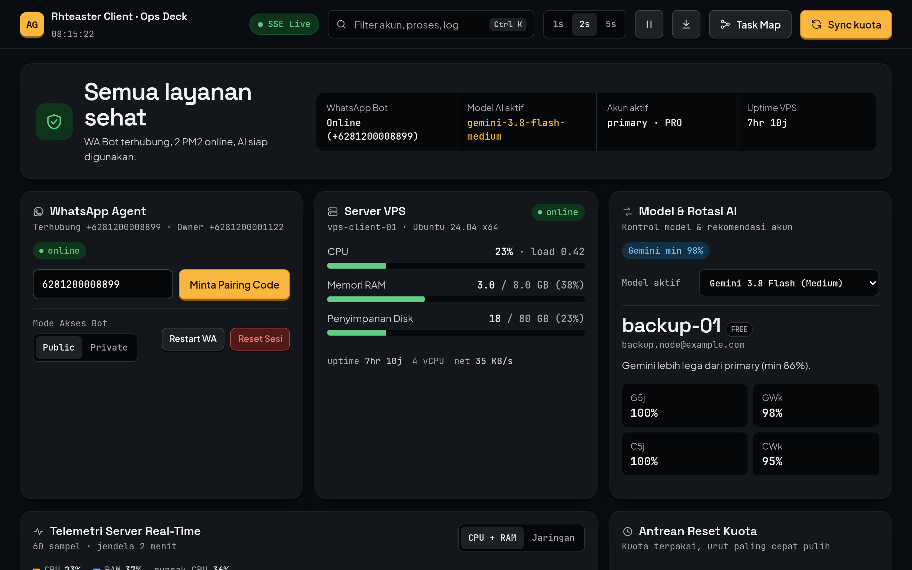
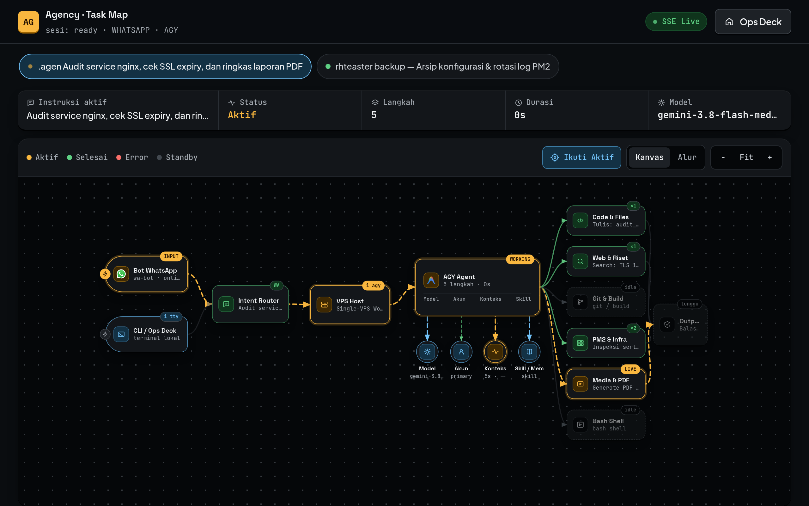
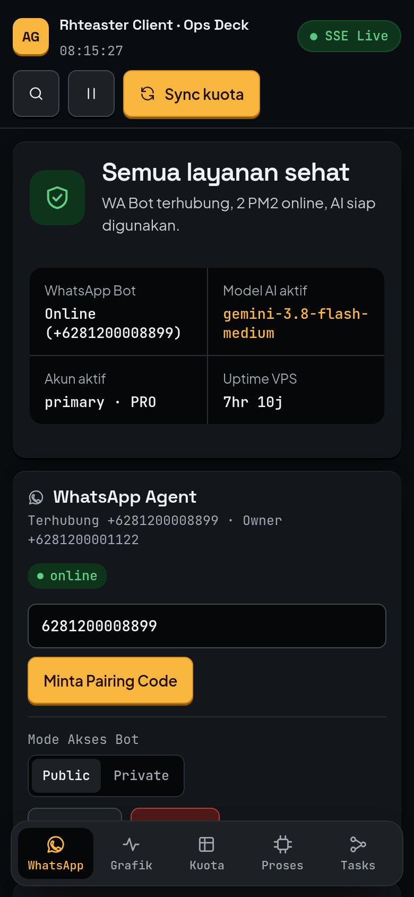
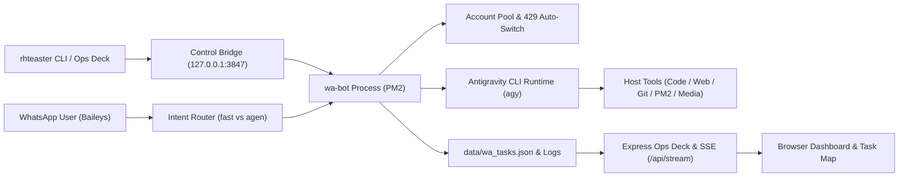

<div align="center">



<br />

[](CHANGELOG.md)
[](package.json)
[](.github/workflows/ci.yml)
[](#quick-start)
[](LICENSE)

**Self-hosted WhatsApp AI Agent, Real-Time Web Ops Dashboard, and VPS CLI Toolkit.**  
Built on Baileys Multi-Device, Google Antigravity CLI (`agy`), Express SSE telemetry, and PM2.

[Quick Start](#quick-start) · [Ops Deck](#web-ops-deck--live-task-map) · [CLI Toolkit](#rhteaster-cli-toolkit) · [Architecture](#architecture) · [WhatsApp Commands](#whatsapp-commands) · [Configuration](#configuration)

</div>

---

## Overview

**Rhteaster** packages an autonomous WhatsApp AI Agent and an Industrial Graphite **Web Ops Deck** into a single-command VPS deployment built for both developers and non-technical operators:

- **One-Command Provisioning**: Installs Node.js v22 LTS, PM2, `ffmpeg`, Antigravity CLI (`agy`), and registers the global `rhteaster` CLI binary.
- **Browser-Based 8-Digit WhatsApp Pairing**: Link a WhatsApp account directly from `http://<VPS_IP>:3000` without scanning QR codes in SSH logs.
- **Smart Intent Router**: Routes quick questions (`.ai`) separately from autonomous multi-step agent tasks (`.agen`) with live step streaming, multimodal attachments, and multi-turn conversation memory.
- **AI Account Pool & 429 Auto-Rotation**: Tracks Gemini & Claude 5-hour/weekly quota windows and rotates accounts automatically on rate limits.
- **Real-Time Telemetry & Live Task Map**: Server-Sent Events (SSE) monitor CPU, RAM, Disk, Network KB/s, PM2 logs, and interactive tool execution graphs (`/task-map`).
- **Dedicated Terminal CLI (`rhteaster`)**: Inspect health diagnostics (`doctor`), manage pairings, rotate models/accounts, edit `config.json`, stream logs, update, and create portable backups.

---

## Quick Start

Run on any fresh **Ubuntu 22.04/24.04** or **Debian 12** VPS:

```bash
curl -sL https://raw.githubusercontent.com/rhteaster-ui/rhteaster/main/setup.sh | bash
```

### Non-Interactive Deployment

Pass configuration flags directly for automated provisioning:

```bash
curl -sL https://raw.githubusercontent.com/rhteaster-ui/rhteaster/main/setup.sh | bash -s -- \
  --name="My Agency" \
  --owner="6281200001122" \
  --bot="6281200008899" \
  --port=3000 \
  --pin="2468" \
  --yes
```

### Post-Install Onboarding

1. **Authenticate Antigravity CLI (once):**
   ```bash
   agy
   ```
   Open the Google OAuth URL printed in your terminal to link your AI account.
2. **Verify System Readiness:**
   ```bash
   rhteaster doctor
   ```
3. **Link WhatsApp from Browser:**
   Open `http://<VPS_IP>:3000`, enter the bot phone number (`628...`) in the **WhatsApp Agent** card, click **Minta Pairing Code**, and enter the 8-digit code under **WhatsApp > Linked Devices > Link with phone number instead**.

---

## Web Ops Deck & Live Task Map

### Operational Cockpit (`/`)

Monitor service health, trigger 8-digit WhatsApp pairing, switch active models, inspect Gemini/Claude quota windows, tail PM2 logs, and toggle `Public` / `Private` mode in real time over SSE.

<p align="center">
  
</p>

### Interactive Task Execution Map (`/task-map`)

Inspect live autonomous workflows across **Intent Router -> VPS Host -> AGY Agent -> Tool Branches** with pan/zoom canvas navigation, mobile flow list view, and step-level detail drawers.

<p align="center">
  
</p>

<details>
<summary>Mobile Responsive Preview (390px Viewport & Bottom Dock)</summary>

<p align="center">
  
</p>

</details>

---

## Architecture



---

## Rhteaster CLI Toolkit

`setup.sh` installs `bin/rhteaster.js` globally as `rhteaster`. You can also invoke it via `npm run cli -- <command>`.

| Command | Description |
| :--- | :--- |
| `rhteaster status [--json]` | Display host CPU/RAM/Disk, PM2 processes, WA bridge state, active model, and AI account pool |
| `rhteaster doctor [--json]` | Run pre-flight diagnostics (Node.js, PM2, git, ffmpeg, `agy` auth, config, directory permissions, bridge, dashboard) |
| `rhteaster pair [phone]` | Request an 8-digit WhatsApp pairing code via the live bridge (or standalone fallback) |
| `rhteaster config [flags]` | Inspect masked configuration or update `--brand`, `--owner`, `--bot`, `--port`, `--pin`, `--clear-pin`, `--mode` |
| `rhteaster model [num_or_id]` | List supported AI models or switch the active model |
| `rhteaster accounts [switch <name>]` | Inspect saved Antigravity profiles or switch the active account |
| `rhteaster start \| stop \| restart` | Control both PM2 services (`wa-bot` and `agent-dashboard`) |
| `rhteaster logs [wa\|dash\|all]` | Inspect PM2 logs (`--lines=50`, `--nostream`) |
| `rhteaster update` | Pull `main` updates (`--ff-only`), install production dependencies, and reload PM2 |
| `rhteaster backup [file.tar.gz]` | Create a portable archive containing `config.json`, `data/`, and `session_auth/` |

---

## WhatsApp Commands

| Command | Function | Access |
| :--- | :--- | :--- |
| `.menu` / `.help` | Show available commands and active bot configuration | Everyone |
| `.agen <task>` | Run autonomous agent task with live progress streaming and file output | Owner |
| `.ai <prompt>` | Fast conversational Q&A, image/sticker, audio, or PDF analysis | Public (when enabled) |
| `$ <cmd>` / `.sh <cmd>` | Execute Linux shell commands on the VPS host | Owner |
| `.model [num]` | View or switch active Gemini / Claude / GPT-OSS model | Owner |
| `.akun` / `.switch <name>` | Inspect saved Google AI accounts and switch active profile | Owner |
| `.saveakun <alias>` | Save currently authenticated `agy` OAuth token into the account pool | Owner |
| `.private` / `.public` | Restrict bot responses strictly to Owner or allow public `.ai` access | Owner |
| `.self on` / `.self off` | Mute or unmute bot responses in a specific WhatsApp group | Owner |
| `.status` / `.pm2` | Report host metrics and PM2 service health directly in WhatsApp | Owner |
| `.reload` / `.restart` | Hot-reload bot modules without dropping Baileys socket, or restart PM2 | Owner |
| `.stop` / `.reset` | Cancel active task or clear current chat conversation memory | Everyone |

---

## Configuration

`setup.sh` and `rhteaster config` generate `config.json` automatically (excluded from Git via `.gitignore`):

| Key | Default | Description |
| :--- | :--- | :--- |
| `brandName` | `"Agency Client"` | Brand header displayed across the Web Ops Deck |
| `botName` | `"Agency AI Bot"` | Bot display name in WhatsApp responses |
| `botNumber` | `""` | Bot WhatsApp phone number (`628...`) |
| `ownerNumber` | `""` | Owner WhatsApp number (`628...`) authorized for privileged commands |
| `prefix` | `"."` | Command prefix |
| `defaultAiModel` | `"gemini-3.8-flash-medium"` | Default model for `.agen` tasks |
| `fastAiModel` | `"gemini-3.8-flash-low"` | Default model for `.ai` fast path |
| `dashboardPort` | `3000` | HTTP port for Web Ops Deck and Live Task Map |
| `dashboardPin` | `""` | Optional PIN locking UI and `/api/*` via HMAC-SHA256 cookies |
| `controlPort` | `3847` | Loopback (`127.0.0.1`) port for bot-to-dashboard control bridge |

---

## Testing & Maintenance

```bash
# Run automated verification suite (bash syntax, JS modules, CLI, auth, privacy checks)
npm test

# Update to latest release and reload PM2 cleanly
rhteaster update

# Create a portable backup before migrating VPS
rhteaster backup ~/rhteaster-backup.tar.gz
```

## Documentation & Policies

- [Design System](DESIGN_SYSTEM.md) — OKLCH palette tokens, typography scale, and responsive grid rules
- [Security Policy](SECURITY.md) — Privilege boundaries, loopback bridge, PIN cookie signing, and credential hygiene
- [Contributing](CONTRIBUTING.md) — Local development workflow and pull request checklist
- [Changelog](CHANGELOG.md) — Version history

## License

Released under the [MIT License](LICENSE).
